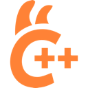
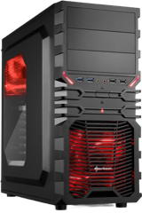

## The bet

In July 2026 I switched off cloud AI for my day-to-day software engineering work. The hypothesis was simple and, in hindsight, a little bold: for the work I actually do, a sufficiently capable model running on my own hardware could replace cloud AI for most tasks without materially reducing my productivity.

I did not expect a clean yes or no, but I did expect the answer to be about replacement. It turned out to be about something else. Local models earned a permanent place in how I work, and cloud models kept theirs. What changed was that I stopped thinking of them as competitors and started routing work between them. I hypothesized replacement; I found complementarity.

This post is a field report rather than a benchmark. I measured what I could with the telemetry my editor already produces, and I describe the rest as my own experience on my own hardware. Where the data can say something, I show it. Where it cannot, I say so.

## Three weeks without cloud AI

The experiment ran from July 9 to July 31, 2026. During those three weeks I did all of my regular work with on-device models only: no frontier model in the editor, no chat assistant in the browser, no quiet exceptions. Before the experiment started I had already turned on the OpenTelemetry export in GitHub Copilot, so every model call, tool call and agent turn from my editor was recorded. On August 1 I switched cloud models back on, and the hybrid period that followed is the second half of the data.

<figure class="diagram diagram--timeline">
<ol class="dg-tl">
<li class="dg-tl-before">

June 2026

Copilot OpenTelemetry recording starts
</li>
<li class="dg-tl-local">

July 9 – July 31, 2026

Cloud AI off: on-device AI only
</li>
<li class="dg-tl-hybrid">
+

August 1, 2026 – today

Hybrid: local and cloud AI together
</li>
</ol>
<figcaption>The experiment: telemetry first, then three weeks of on-device AI only, then cloud models back on for a hybrid period that is still running.</figcaption>
</figure>

Three weeks is long enough to stop treating the setup as a novelty. By the second week the question was no longer whether a local model could answer a prompt, but whether I could get through a normal working day with it. That is a much harder and more honest test.

## Running a model means running a stack

The first thing I learned is that "running a local model" is not a single decision. It is a stack of decisions, and every layer can make or break the experience.

<figure class="diagram diagram--stack">

<h4>Model development &amp; preparation</h4>
Where models are created, adapted and prepared (out of scope here)

<h5>Model creation &amp; adaptation</h5>
Pre-training / model buildingFine-tuning

<h5>Optimization &amp; packaging</h5>
QuantizationPackaging &amp; export

↕

<svg class="dg-icon" viewBox="0 0 24 24" aria-hidden="true"><ellipse cx="12" cy="5" rx="8" ry="3"/><path d="M4 5v14c0 1.7 3.6 3 8 3s8-1.3 8-3V5M4 12c0 1.7 3.6 3 8 3s8-1.3 8-3"/></svg>
<h4>Model artifacts &amp; repositories</h4>
e.g. Hugging Face Hub, GitHub

Models are downloaded for inference, or pushed back after preparation.

<svg class="dg-icon" viewBox="0 0 24 24" aria-hidden="true"><circle cx="8" cy="8" r="3"/><circle cx="16" cy="8" r="3"/><path d="M2 20c0-3.3 2.7-6 6-6s6 2.7 6 6M10 20c0-3.3 2.7-6 6-6s6 2.7 6 6"/></svg>
<h4>Consuming applications / clients</h4>
Chat UI, IDEs (VS Code), agents, custom apps

↕

<svg class="dg-icon" viewBox="0 0 24 24" aria-hidden="true"><rect x="3" y="4" width="18" height="7" rx="1.5"/><rect x="3" y="13" width="18" height="7" rx="1.5"/><path d="M7 7.5h.01M7 16.5h.01"/></svg>
<h4>Serving &amp; integration layer</h4>
APIs, web UI, orchestration, auth, prompt management, RAG, tools

↕

<h4 style="text-align:center">Model execution stack (on-device)</h4>
How models are executed

<h5>Model execution software</h5>

<h4>Inference engines &amp; runtimes</h4>
llama.cpp, MLX-LM, vLLM, OpenVINO Runtime, ONNX Runtime, TensorRT-LLM

<h5>Execution foundation</h5>

<h4>Compute backends &amp; accelerator APIs</h4>
CUDA, Metal, Vulkan, ROCm, oneDNN, OpenCL, CPU kernels

<ul class="dg-options" aria-label="Options at every layer">
<li>Quants Q4 / Q5 / Q6 / mixed precision</li><li>KV-cache quantization</li><li>TurboQuant</li><li>ANE</li><li>MTP heads</li><li>DFlash drafter models</li><li>Dense / MoE / MoA models</li><li>Harnesses</li><li class="dg-muted">…so many possibilities, settings and options</li>
</ul>

<h4>Hardware (on-device)</h4>

<svg class="dg-icon" viewBox="0 0 24 24" aria-hidden="true"><rect x="6" y="6" width="12" height="12" rx="1.5"/><path d="M9 2v4M15 2v4M9 18v4M15 18v4M2 9h4M2 15h4M18 9h4M18 15h4"/></svg><b>CPU</b> cores

<svg class="dg-icon" viewBox="0 0 24 24" aria-hidden="true"><rect x="2" y="6" width="20" height="11" rx="1.5"/><circle cx="9" cy="11.5" r="3"/><path d="M15 9h4M15 12h4M5 17v3M19 17v3"/></svg><b>GPU / unified memory</b> VRAM, bandwidth, compute

<svg class="dg-icon" viewBox="0 0 24 24" aria-hidden="true"><rect x="7" y="7" width="10" height="10" rx="1.5"/><path d="M12 2v5M12 17v5M2 12h5M17 12h5M5 5l3 3M16 16l3 3M19 5l-3 3M8 16l-3 3"/></svg><b>NPU / AI accelerator</b>

<svg class="dg-icon" viewBox="0 0 24 24" aria-hidden="true"><rect x="2" y="8" width="20" height="8" rx="1"/><path d="M6 11v2M10 11v2M14 11v2M18 11v2M5 16v3M19 16v3"/></svg><b>RAM</b> system memory

<svg class="dg-icon" viewBox="0 0 24 24" aria-hidden="true"><rect x="5" y="2" width="14" height="20" rx="2"/><path d="M9 6h6M9 18h.01"/></svg><b>Storage</b> SSD / NVMe

<figcaption>The on-device model stack: what I had to choose at every layer, from hardware to the client in my editor. Model preparation sits next to it and was out of scope for the experiment.</figcaption>
</figure>

I ran the experiment on two machines. The first is a MacBook Pro with an M5 Max and 64 GB of unified memory. The second is a home-built Ubuntu desktop with two RTX 3060 cards of 12 GB each, built on an older platform: an Intel i5-4690K, 32 GB of DDR3 on an MSI Z97 Krait board, and an 850 W power supply.

On the Mac I mostly serve models through LM Studio. Along the way I tried a long list of other runtimes and inference engines, including DFlash, oMLX and MTPLX. Today, LM Studio with the Splash engine is by far the best overall option for Qwen 3.8 27B on that machine. On the desktop I run llama.cpp directly. The main model there is a Q4 quantization of the same Qwen 3.8 27B, split across both GPUs with tensor split, with multi-token prediction turned on, some kernel customization, and a community "GPU unlocker" project that enables additional cores NVIDIA keeps locked on consumer cards.

None of that is plug-and-play. Quantization level, KV-cache settings, context length, drafter models and the runtime itself all moved the result, sometimes by a lot. A model that felt unusable with one configuration was perfectly fine with another. That is the hidden cost of local AI: you are not just choosing a model, you are operating AI infrastructure.

## The model-size sweet spot

The second lesson was about size. Smaller models are fast and cheap to run, but below a certain size they stop being useful for agentic coding work. Larger models do not fit comfortably on the hardware I have. In between there is a class of models that, for me, hits the sweet spot.

<figure class="diagram diagram--sizes">
<ol class="dg-steps">
<li class="dg-step">
~4B

<ul><li>Basic Q&amp;A</li><li>Limited instruction following</li></ul><strong>Use:</strong><ul><li>Lightweight extraction</li></ul>
</li>
<li class="dg-step">
~8B

<ul><li>Factual / coding assistance</li><li>Handles bounded, well-specified tasks</li></ul><strong>Use:</strong><ul><li>Knowledge bots</li><li>Summarization</li></ul>
</li>
<li class="dg-step">
~15B

<ul><li>Short-horizon agentic work</li><li>Can understand and modify existing code</li></ul><strong>Use:</strong><ul><li>Single unit tests</li><li>Small Python functions</li><li>Repo search</li><li>Single-tool workflows</li></ul>
</li>
<li class="dg-step dg-step--sweet">
Dense: 3.8 – 27B MoE: 3.6 – 35B-A3B

~25B–35B

<ul><li>Strong coding and reasoning capability</li><li>Useful medium- and long-horizon agentic behavior</li></ul><strong>Use:</strong><ul><li>Complex implementation</li><li>Repo-wide work</li><li>Multi-step agentic tasks</li><li>General assistant intelligence</li></ul>
</li>
<li class="dg-step dg-step--beyond">
&gt; 35B

…
</li>
</ol>

Total model parameters (B for billions)

<figcaption>Model size versus what I could use it for. The ~25–35B class, dense and mixture-of-experts, served me best in day-to-day work.</figcaption>
</figure>

For my work, that sweet spot is the 25–35 billion parameter class. In practice that meant the dense Qwen 3.8 27B and the mixture-of-experts Qwen 3.6 35B-A3B. Note that the two numbers are not directly comparable: a mixture-of-experts model with 35 billion total parameters only activates about 3 billion of them per token, so it is much faster than a dense 27B model but behaves differently on harder tasks.

This is a statement about my hardware and my work, not a general ranking. With more memory, the sweet spot moves up. With a different workload, it might move down.

## What the usage data shows

Because Copilot was exporting telemetry the whole time, I can look at how the two periods actually differ. The explorer below is built from a frozen snapshot of that data through September 9, 2026. It opens on the comparison I find most telling: every model call plotted by the size of its input and the trajectory score of the prompt it belonged to, once for the local-only period and once for the hybrid period, on identical logarithmic axes.

The trajectory score is a simple activity measure per prompt. It adds the logarithms of three things: how many sequential agent iterations the prompt took, how far into a chat session the prompt was, and how many tool calls were linked to it. It deliberately leaves out reasoning tokens, which the telemetry does not record, and output tokens, which measure verbosity as much as work. A high score means more observed agent activity, not a harder or better task.

During the local-only weeks, local models handled 1,419 calls, and the bulk of them sat between 10,000 and 100,000 input tokens, with the median at about 33,000. In the hybrid period the picture splits. Local calls stayed in the same place, with a median of about 33,000 input tokens. Cloud calls moved to the right: their median input was about 84,000 tokens, and 648 of 1,614 cloud calls were 100,000 tokens or more, compared to only 40 of 1,587 local calls. The separate columns at the left are Copilot's own helper models, which handle small background requests in the editor and are not models I chose.

I did not plan that division. It is what happened once I could choose again: large-context work went to the cloud, and the steady stream of small and medium tasks stayed local. The explorer also has a daily view of the two periods and a breakdown of prompt sizes, and its method note lists what is excluded. In particular, I removed 754 cloud calls from July 9–31 that were not part of the experiment. The data shows how I used the models, not how productive I was or how good the code turned out.

## Where local helped, and where it struggled

Local models were good at more than I expected. Repo search and code understanding were reliable. Writing unit tests was a strong fit. So was spotting bugs, brainstorming possible solutions, and command-line work. Bounded implementation was the real surprise: when a larger frontier model had written a clear specification, a 27B local model implemented features from it well. It was also useful for less obvious jobs, such as turning PDFs into HTML versions we could use as templates, or brainstorming different ways to rewrite text for articles.

Once the hardware and runtime settings were tuned, performance was good enough that I stopped noticing it. Local inference also has two quieter benefits: predictable cost, and no dependency on whether a cloud service is available or rate-limited that afternoon.

Where it struggled was just as clear. Long refactors that touch many files drifted. Very large repositories pushed against context limits and slowed everything down. And questions that need broad, current knowledge rather than reasoning alone, such as detailed Terraform questions about Azure, were where frontier models were simply better. A smaller model can reason well about code in front of it; it cannot know what it was never trained on. Complex architecture questions were less reliable locally, and long, high-iteration agent runs still favored the frontier models.

And of course, getting there took significant tinkering. Performance depended heavily on the runtime, the quantization and the hardware configuration.

## The workflow that stayed

When I turned cloud models back on, I did not simply go back to how I worked before. Over the following weeks a workflow settled in that uses each tier for what it is good at. It is a form of spec-driven development.

<figure class="diagram diagram--workflow">

Cloud AI
<ol class="dg-steps-row">
<li class="dg-node">
<b>1</b>Brainstorm &amp; design the spec

+

Together with me, the cloud model writes the specification.
✓ I approve the spec</li>
<li class="dg-node">
<b>2</b>Spec → tasks with a plan

The cloud model breaks the spec into small tasks and routes each one to a worker.
✓ I approve the tasks✓ I choose the model per task</li>
<li class="dg-node">
<b>4</b>Cloud model reviews the code

If the output is insufficient, the task goes back to its worker with feedback.
↺ back to the worker</li>
</ol>

3 · Workers write code / perform the task
<ul class="dg-lanes">
<li class="dg-lane">++3.8 27B</li>
<li class="dg-lane">++3.8 27B</li>
<li class="dg-lane">++3.5 Lightning 30B-3B</li>
</ul>

<b>5</b><svg class="dg-icon" viewBox="0 0 24 24" aria-hidden="true"><circle cx="12" cy="8" r="4"/><path d="M4 21c0-4.4 3.6-8 8-8s8 3.6 8 8"/></svg>Final review by me
✓ I approve the result

<figcaption>The hybrid, spec-driven workflow: cloud models design, plan and review; local models do the implementation work; I approve at every gate.</figcaption>
</figure>

It starts with me and a frontier cloud model in VS Code, brainstorming and turning an idea into a written specification. Nothing moves until I approve that spec. The cloud model then breaks it into small tasks with a plan, and I approve that breakdown too, including which model runs each task. Most implementation tasks go to local workers: Qwen 3.8 27B on the desktop or the MacBook, or an NVIDIA 30B mixture-of-experts model when speed matters more than depth. When a worker finishes, a cloud model reviews the result. If the output is not good enough, the task goes back to the worker with concrete feedback. When everything is done, the code comes to me for a final review.

The roles follow the data. The cloud tier does what needs long context, broad knowledge and careful judgment: design, planning and review. The local tier does the bulk of the bounded execution, where a capable 27B model is fast, predictable and essentially free to run. The tasks are small enough that context stays manageable, and the spec is clear enough that a local model does not need to guess.

## The agent behind the workflow

I eventually encoded this workflow as a custom agent for VS Code Copilot: the PI Harness Spec Orchestrator. It turns a request into an approved specification and small tasks, asks me to choose the exact model for each PI worker, dispatches the work, has the result reviewed, and only closes a task after I approve it. The orchestrator itself is model-agnostic. The split between cloud and local in the diagram above is how I use it, not something hardcoded.

Three small skills handle the mechanics. The first runs each PI worker in a visible, persistent Terminal session, so I can watch what it does and step in when needed. The second records the handoffs, progress and recovery checkpoints for each task in the repository, so work survives a restart. The third handles a worker that stops making progress: it checks the evidence and asks me how to recover, instead of silently retrying.

**Download the [PI Harness Spec Orchestrator (v9) and its three skills](/assets/downloads/pi-harness-spec-orchestrator-v9.zip).** The bundle contains the orchestrator agent, the `running-visible-pi-subagents`, `tracing-agent-orchestration`, and `handling-subagent-stalls` skills, and a README with setup requirements (VS Code Copilot, PI, tmux, macOS Terminal). Configure model IDs for your own environment before use. Licensed under Apache 2.0.

So, did local AI replace cloud AI? No. It became a complementary compute tier. Local models can cover a meaningful share of professional coding work, especially bounded implementation, repo exploration, code understanding and medium-complexity tasks. The strongest setup is hybrid: local models for capable, cost-effective execution, and frontier models for long context, deep reasoning, orchestration and final review. And running local AI means running AI infrastructure. The best results require tuning models, runtimes, memory, quantization, context and hardware. It is not a plug-and-play replacement for the cloud, but with some care it is a very good partner to it.
